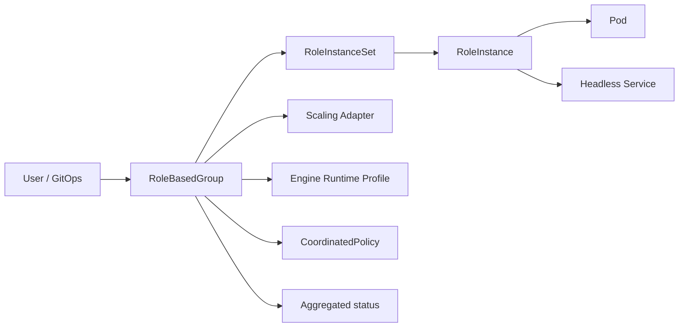

# Architecture

RBG is a Kubernetes-native control plane for role-based, distributed, stateful inference workloads. It treats an inference service as a coordinated group of roles rather than as a loose collection of independent workloads.

## Core objects

RBG uses a layered object model:

1. **RoleBasedGroup / RoleBasedGroupSet** — the user-facing API. A RoleBasedGroup defines a complete inference topology; a RoleBasedGroupSet manages many replicas of the same topology.
2. **RoleInstanceSet** — the native workload that RBG creates for each role. It owns a set of RoleInstances and their rollout, scaling, and recovery policies.
3. **RoleInstance** — one inference instance for a role. A RoleInstance may own one Pod, a leader/worker Pod set, or a custom multi-component Pod group.
4. **Pods** — the actual inference engines and their supporting sidecars.

The controller also creates and manages several helper objects:

- **RoleBasedGroupScalingAdapter** — a scale target for HPA/KEDA/KPA that maps autoscaler decisions back to a specific role.
- **CoordinatedPolicy** — a separate policy object that keeps multi-role rolling updates and scaling within a configured skew.
- **ClusterEngineRuntimeProfile** — a cluster-scoped profile that injects shared runtime settings, sidecars, volumes, and patches into role pods.
- **RoleBasedGroupWarmup** — a prewarming helper used by some inference engines before traffic is admitted.

## Controller flow

The RBG controller continuously reconciles the desired role topology:

1. It validates the role specification, including pattern selection, restart policy, rollout strategy, and runtime profile references.
2. It creates or updates the matching RoleInstanceSet for each role.
3. The RoleInstanceSet controller creates RoleInstances according to the selected pattern:
   - **StandalonePattern** — one Pod per instance.
   - **LeaderWorkerPattern** — one leader and one or more workers per instance, typically for tensor-parallel inference.
   - **CustomComponentsPattern** — multiple named components with explicit ordering and discovery relationships.
4. The RoleInstance controller creates and updates the owned Pods, headless Services, and per-instance status.
5. The RBG controller aggregates role and instance status into the parent RoleBasedGroup, including readiness, rollout progress, restart budgets, and blocking conditions.
6. Optional controllers apply cross-role CoordinatedPolicy rules, gang scheduling annotations, exclusive-topology constraints, port allocation, and engine runtime profile injection.

## Reconciliation and status

RBG does not hide workload state behind a single ready/not-ready bit. The status model is aggregated from the underlying RoleInstanceSets and RoleInstances:

- Each role reports desired, current, ready, updated, and available counts.
- Each RoleInstance reports its readiness, restart budget, rollout state, and per-component health.
- The parent group exposes Kubernetes conditions such as `Ready`, `Progressing`, `Degraded`, and role-specific blockers.

This makes CLI and automation behavior deterministic: `kubectl get rbg` shows a concise view, while `kubectl describe rbg` and the API expose the full breakdown.

## Deployment patterns

RBG supports the common LLM serving topologies without forcing users to hand-build a graph of Deployments and StatefulSets.

### Aggregated single node

A single engine handles both prefill and decode on one node. This is useful for small models and low-latency, low-throughput deployments.

### Aggregated multi node

One logical inference instance spans multiple nodes, typically for tensor parallelism. RBG uses LeaderWorkerPattern or CustomComponentsPattern to keep the Pods of one instance together and inject the required discovery information.

### Prefill/decode disaggregated

Prefill and decode run as separate roles with independent scaling and rollout policies. A CoordinatedPolicy can keep the two roles from drifting too far apart during updates or scaling.

## Service discovery and scheduling

RBG injects a complete role topology into Pods as environment variables and Kubernetes labels. This removes the need for a separate service registry and makes component startup order explicit.

For performance-sensitive inference, RBG integrates with:

- scheduler-plugins gang scheduling,
- Volcano gang scheduling,
- exclusive topology placement,
- topology-aware node selection,
- port allocation for multi-process engines.

## Compatibility mode

RBG keeps a compatibility path for existing v1alpha1 users, but the preferred API is `workloads.x-k8s.io/v1alpha2`. The deprecated `Deployment`, `StatefulSet`, and `LeaderWorkerSet` role workload types are superseded by `RoleInstanceSet`. New installations should use v1alpha2 patterns directly; existing users should follow the migration guide.

See [Migrate v1alpha1 to v1alpha2](/docs/migration-v1alpha1-to-v1alpha2) for the detailed migration path.
