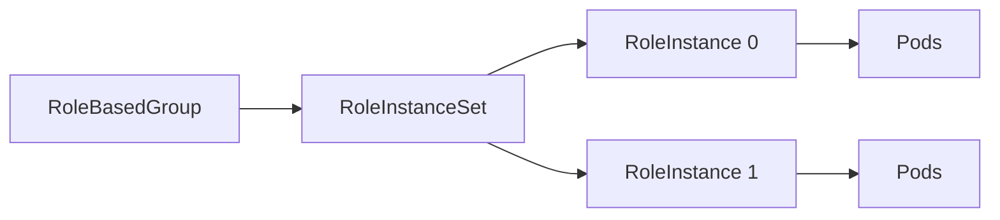

# RoleInstance and RoleInstanceSet

RBG v1alpha2 uses two native workload objects:

- **RoleInstanceSet** — the workload controller object created for each role.
- **RoleInstance** — one inference instance owned by that set.

A `RoleInstance` owns one or more Pods and their headless Services. It is the unit that RBG uses for rollout, restart, readiness, and status aggregation.

## RoleInstanceSet

`RoleInstanceSet` is the workload that RBG creates for each role. It is not a generic Kubernetes StatefulSet or Deployment; it understands the role's pattern and the lifecycle of the RoleInstances it owns.

```yaml
apiVersion: workloads.x-k8s.io/v1alpha2
kind: RoleInstanceSet
metadata:
  name: inference-prefill
spec:
  replicas: 2
  selector:
    matchLabels:
      rbg.workloads.x-k8s.io/role-instance-owner: inference-prefill
  roleInstanceTemplate:
    spec:
      components:
        - name: prefill
          size: 1
          template:
            spec:
              containers:
                - name: prefill
                  image: example/inference:latest
```

You normally do not create this object directly. RBG creates and manages it from the role definition in your RoleBasedGroup.

## RoleInstance

`RoleInstance` represents one inference instance for a role.

Depending on the role pattern, a RoleInstance can own:

- one Pod (`standalonePattern`),
- one leader Pod and one or more worker Pods (`leaderWorkerPattern`),
- a set of named component Pods (`customComponentsPattern`).

```yaml
apiVersion: workloads.x-k8s.io/v1alpha2
kind: RoleInstance
metadata:
  name: inference-prefill-0
spec:
  restartPolicyConfig:
    type: RecreateRoleInstanceOnPodRestart
    activateAfter: Ready
  components:
    - name: prefill
      size: 1
      template:
        spec:
          containers:
            - name: prefill
              image: example/inference:latest
```

## Readiness

RBG aggregates readiness from the RoleInstance to the RoleInstanceSet and then to the parent RoleBasedGroup.

| Field | Meaning |
|---|---|
| `spec.readyPolicy` | How component readiness is aggregated. |
| `spec.readinessGates` | Additional gates evaluated before the instance is Ready. |
| `status.phase` | Current lifecycle phase. |
| `status.conditions` | Standard conditions, including `RoleInstanceReady`. |

## Restart and recovery

For multi-Pod RoleInstances, use `restartPolicyConfig` to control restart and recovery behavior:

```yaml
restartPolicyConfig:
  type: RecreateRoleInstanceOnPodRestart
  activateAfter: Ready
  baseDelaySeconds: 30
  maxDelaySeconds: 600
  maxGroupRestarts: 3
```

See [Failure Handling](/docs/features/failure-handling) for the full restart and bounded group-recovery semantics.

## In-place update

RoleInstance supports in-place updates when only mutable Pod fields change, such as a container image. When the update is not in-place eligible, RBG falls back to recreating the Pod according to the role's rollout strategy.

See [Update Strategy](/docs/features/update-strategy) for the rollout policy.

## Headless Services

Each RoleInstance can expose a headless Service for stable DNS names. This is useful for leader/worker and custom-component patterns where the components need to discover each other.

## Relation to RoleBasedGroup

You normally define the desired topology in a RoleBasedGroup. The controller then creates one RoleInstanceSet per role and one RoleInstance per replica:



Use [Workload Patterns](/docs/features/patterns) to choose how the Pods inside each RoleInstance are organized.
