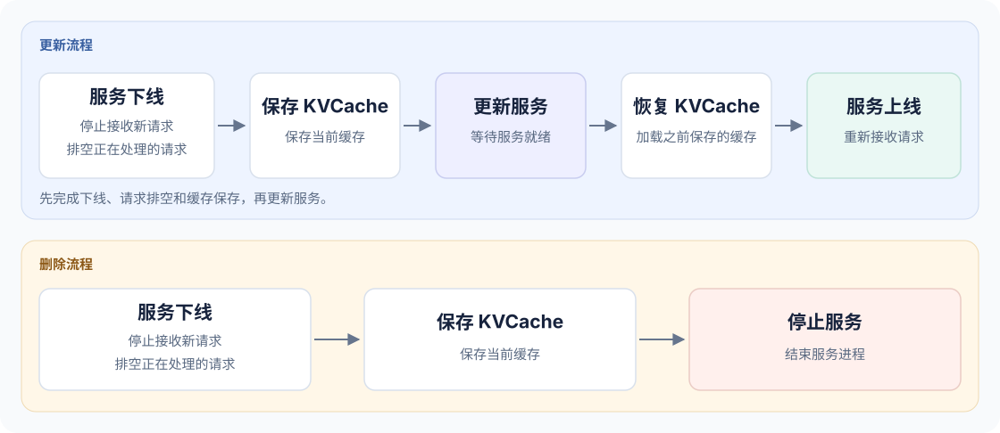
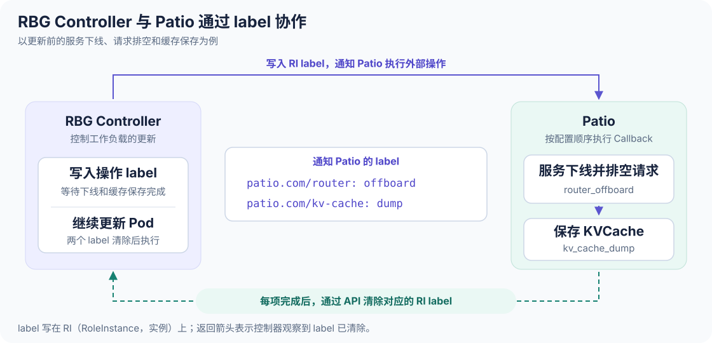
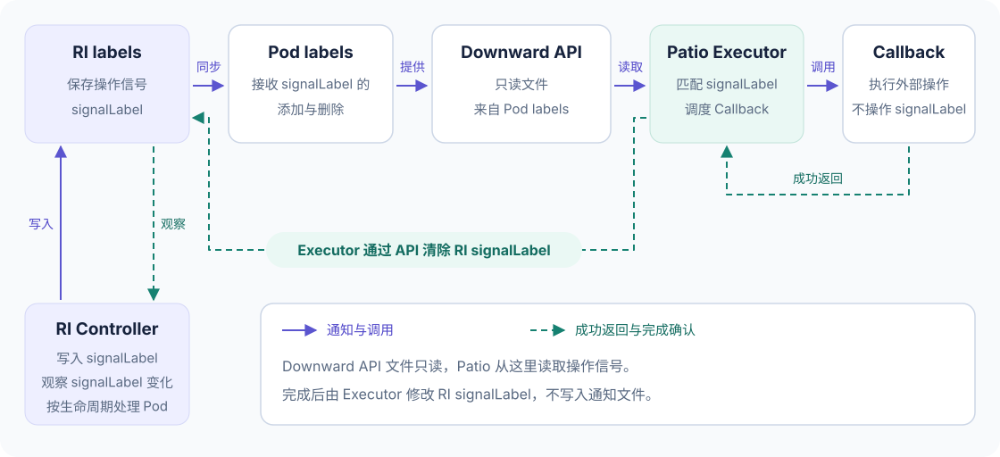
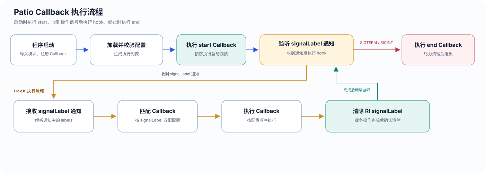
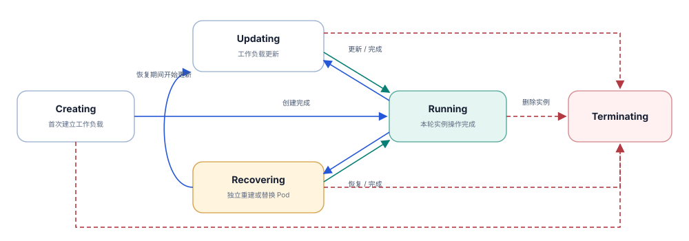
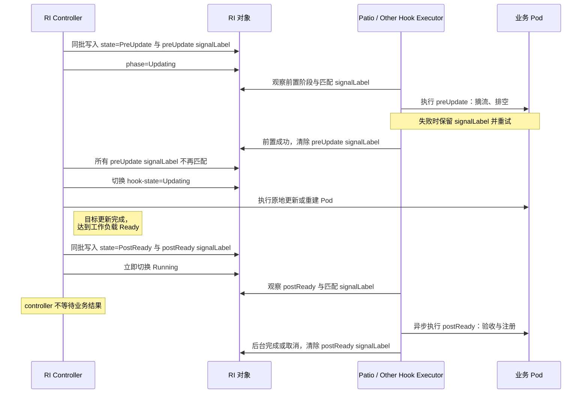

<div className="ri-proposal-summary" lang="zh-CN">
  <div className="proposal-eyebrow">设计提案 <span>Provisional · Alpha</span></div>
  <p className="proposal-lead">在 Pod 更新、删除前完成必要的业务操作</p>
  <p>推理服务更新或删除前，可能需要先停止接收新请求，等待已有请求结束，再保存缓存。本文以这一需求为例，介绍 RBG 如何等待 Patio 完成这些操作后再更新或删除 Pod，以及如何在工作负载就绪后触发缓存恢复和服务上线。</p>
</div>

<!-- truncate -->

<div className="ri-proposal" lang="zh-CN">

:::info 阅读范围
本文介绍 RBG 的生命周期 Hook 和 Patio 的业务回调函数（Callback）。下方配置省略了工作负载模板，不能直接部署。
:::

## 01 · 背景与目标 {#motivation}

以需要在更新时保存 KVCache 的推理服务为例，更新前要先停止向待更新实例发送新请求，等待正在处理的请求结束，再保存缓存。如果这些操作尚未完成就更新 Pod，正在处理的请求可能被中断，缓存保存也可能无法完成。因此，控制器需要知道这些业务操作何时完成，才能继续更新。

Pod Ready 可以作为工作负载就绪的判断依据，但不能单凭这个状态认定缓存已恢复、路由已注册。业务操作之间也需要协调：例如，注销路由后若 heartbeat 仍在发送注册请求，服务就可能再次接收流量。仅将注册、注销绑定到进程启动和退出，无法保证更新期间所需的操作顺序。

本文提出的方案允许用户在定义 RBG 时，指定更新、删除前以及工作负载就绪后需要执行的外部操作。RBG 在对应阶段通知 Patio，由 Patio 调用业务函数；对于必须在更新、删除前完成的操作，RBG 等待完成确认后再变更工作负载。用户可以配置自己的路由和缓存处理逻辑，无需将这些业务逻辑写入 RBG 控制器。

## 02 · 用户故事 {#user-story}

### 服务更新与删除的需求

<figure className="proposal-figure">
  <a href="/img/ri-lifecycle-journey.svg" target="_blank" rel="noopener noreferrer" aria-label="在新标签页打开服务更新与删除流程图">
    
  </a>
  <figcaption>图 1 · 服务更新与删除流程</figcaption>
</figure>

本例要求更新和删除前都保存 KVCache。图中的“下线”表示停止接收新请求，此时服务进程仍需运行以处理完已有请求并保存缓存。这些操作完成后，才能更新或停止服务。

### 用 RBG 和 Patio 实现

<figure className="proposal-figure">
  <a href="/img/ri-marker-roundtrip.svg" target="_blank" rel="noopener noreferrer" aria-label="在新标签页打开 RBG Controller 与 Patio 的 label 协作循环图">
    
  </a>
  <figcaption>图 2 · 以更新前的操作为例：RBG Controller 写入 label 通知 Patio，Patio 完成操作后清除 label，控制器观察到变化后继续处理。</figcaption>
</figure>

用户在 RBG Role 的 `lifecycle` 中声明各阶段要写入的 label key/value，作为操作信号（signal）；在 Patio 的 `events.yaml` 中，将这些信号对应到业务回调函数（Callback），并指定执行顺序。

实现上述流程，用户分别为 RBG 和 Patio 添加以下配置。

<div className="proposal-config-comparison" role="region" aria-label="RBG 与 Patio 配置对照，可横向滚动" tabIndex={0}>
<table className="proposal-config-table">
  <thead>
    <tr>
      <th scope="col">RBG</th>
      <th scope="col">Patio</th>
    </tr>
  </thead>
  <tbody>
    <tr>
      <td>

```yaml
apiVersion: workloads.x-k8s.io/v1alpha2
kind: RoleBasedGroup
metadata:
  name: inference-group
spec:
  roles:
    - name: prefill
      lifecycle:
        preUpdate:
          signalLabels:
            patio.com/router: offboard
            patio.com/kv-cache: dump
        preDelete:
          signalLabels:
            patio.com/router: offboard
            patio.com/kv-cache: dump
        postReady:
          signalLabels:
            patio.com/router: onboard
            patio.com/kv-cache: restore
      engineRuntimes:
        - profileName: patio
```

      </td>
      <td>

```yaml
event_callbacks:
  start:
    - router_onboard

  hook:
    # hook used to restore kvCache and register worker to router
    - signal: "patio.com/kv-cache=restore"
      callback: kv_cache_restore
    - signal: "patio.com/router=onboard"
      callback: router_onboard

    # hook used to unregister worker from router and dump kvCache
    - signal: "patio.com/router=offboard"
      callback: router_offboard
    - signal: "patio.com/kv-cache=dump"
      callback: kv_cache_dump

  end:
    - router_offboard
```

      </td>
    </tr>
  </tbody>
</table>
</div>

左侧的 `preUpdate` 和 `preDelete` 对应图 1 中更新前、删除前的操作，两者都声明下线和保存缓存的信号；`postReady` 对应工作负载就绪后的缓存恢复与上线。

两份配置通过相同的 key/value 对应。例如，左侧的 `patio.com/router: offboard` 在右侧写为 `patio.com/router=offboard`，Patio 匹配到这个信号后调用 `router_offboard`，完成下线和请求排空。保存缓存则由 `patio.com/kv-cache=dump` 对应的 `kv_cache_dump` 执行。

操作顺序由右侧 `hook` 列表决定，左侧 label 的排列不表示执行顺序。因此，虽然左侧 `postReady` 先列出 router，右侧仍会在两个信号都匹配时，先调用 `kv_cache_restore`，再调用 `router_onboard`。更新和删除前同理：先下线并排空请求，再保存缓存。

:::warning 有先后顺序的操作需要同时设置 signalLabel
要先恢复缓存再上线，需要将这两个 signalLabel 在同一次操作中写入，由同一个 Patio Executor 执行。如果只收到上线 signalLabel，即使恢复操作排在列表前面，Patio 也不会等待它，而会执行上线操作。
:::

配置中的 `start`、`end` 分别用于 Patio 进程启动和退出，与 RBG 触发的 hook 不同。它们的执行时机和退出清理规则见[第四章](#patio)。

## 03 · RBG 与 Patio 如何传递操作信号 {#collaboration}

<figure className="proposal-figure">
  <a href="/img/ri-marker-delivery.svg" target="_blank" rel="noopener noreferrer" aria-label="在新标签页打开 signalLabel 通知与完成确认路径图">
    
  </a>
  <figcaption>图 3 · signalLabel 经文件通知 Patio，操作完成后通过 API 清除。</figcaption>
</figure>

RI（RoleInstance）是 RBG 管理的实例，可以包含多个 Pod。操作信号保存在 RI 的 labels 中。RBG 将这些 signalLabel 同步到 Pod labels，再通过 Downward API 以只读文件的形式提供给 Patio。因此，Patio 从文件中读取信号，完成确认则需要修改 RI 上的 signalLabel。

| 组件 | 在这个过程中的职责 |
| ---- | ---- |
| RI Controller | 按生命周期配置写入 RI signalLabel；对于前置 Hook，等待完成确认后再操作 Pod。不执行路由或缓存业务。 |
| Patio Executor | 匹配 signalLabel、调用 Callback，成功后通过 API 清除对应的 RI signalLabel，并处理重试。不修改工作负载 spec。 |
| 业务 Callback | 执行路由上下线、请求排空、缓存保存与恢复。不自行维护 Kubernetes signalLabel。 |

Callback 成功返回后，由 Executor 发起 signalLabel 清除，并确认清除结果。图中从 RI 指向 Controller 的箭头表示控制器观察到了 label 变化，不是 Callback 直接通知控制器。Downward API 文件始终是只读通知来源，不能通过修改文件来确认操作完成。

signalLabel 的添加和删除都需要同步到 Pod labels，并反映到通知文件中。普通 metadata 同步不得覆盖这些运行时 signalLabel，否则可能将已清除的 signalLabel 重新补回，重复触发业务操作。

## 04 · Patio 如何执行 Callback {#patio}

### 事件执行流程

<figure className="proposal-figure">
  <a href="/img/event-handler-flow.svg" target="_blank" rel="noopener noreferrer" aria-label="在新标签页打开 Patio 事件执行流程图">
    
  </a>
  <figcaption>图 4 · Patio 的启动、Hook 处理与退出流程。</figcaption>
</figure>

Patio 启动时先导入 Callback 模块完成注册，再读取、校验配置并生成执行列表。注册时保存函数引用，加载配置时选择函数，执行阶段才调用函数。下文介绍 Callback 的开发、注册和配置解析；图中只展示主要阶段，Executor 的执行进度保存、重试和并发控制不在本提案中展开。

### 开发与注册 Callback

开发者将业务操作实现为异步函数，再用 `@register_callback` 为它登记一个名称。用户在配置中通过这个名称选择操作。例如，`router_offboard` 负责下线，停止 heartbeat、注销和排空请求的顺序由函数内部保证。

```python
@register_callback("router_onboard")
async def router_onboard() -> None:
    # 确认 ready → 注册 → 启动 heartbeat
    ...

@register_callback("router_offboard")
async def router_offboard() -> None:
    # 停止 heartbeat → 收束注册 → 注销 → 排空
    ...

@register_callback("kv_cache_dump")
async def kv_cache_dump() -> None:
    # 保存 KVCache
    ...

@register_callback("kv_cache_restore")
async def kv_cache_restore() -> None:
    # 恢复 KVCache
    ...
```

Callback 需要支持幂等执行。业务操作和清除 signalLabel 是两个步骤：即使操作已经成功，如果 signalLabel 清除尚未得到确认，重试时仍可能再次调用同一个 Callback。

装饰器将名称和函数引用保存到公共注册表 `callback_plugins`，不在注册阶段执行业务。各插件模块共享同一个注册入口，名称重复时拒绝覆盖。下面是注册表和装饰器的实现示意：

```python
from collections.abc import Awaitable, Callable

EventCallback = Callable[[], Awaitable[None]]
callback_plugins: dict[str, EventCallback] = {}

def register_callback(name: str):
    def decorator(callback: EventCallback):
        if name in callback_plugins:
            raise ValueError("Callback plugin 重复注册")
        callback_plugins[name] = callback
        return callback
    return decorator

# 启动：显式导入受信任模块 → 校验配置 → 绑定
```

Patio 启动时显式导入受信任的 Callback 模块，让装饰器完成注册。YAML 只引用注册名称，不用于动态导入 Python 模块。

### 加载配置

以用户故事中的 Patio 配置为输入，将 Callback 名称解析为上一节注册表中的函数引用：

```yaml title="events.yaml"
event_callbacks:
  start:
    - router_onboard
  hook:
    - signal: "patio.com/kv-cache=restore"
      callback: kv_cache_restore
    - signal: "patio.com/router=onboard"
      callback: router_onboard
    - signal: "patio.com/router=offboard"
      callback: router_offboard
    - signal: "patio.com/kv-cache=dump"
      callback: kv_cache_dump
  end:
    - router_offboard
```

下面的代码沿用上一节的 `EventCallback` 和 `callback_plugins`，使用 PyYAML 读取文件。示例只展示解析和绑定，省略配置结构与 signalLabel 格式校验；这些校验应在执行任何 Callback 前完成。

```python title="解析配置并生成执行列表"
from dataclasses import dataclass

import yaml


@dataclass(frozen=True)
class HookBinding:
    signal: str
    callback: EventCallback


def load_event_bindings(path: str):
    with open(path, encoding="utf-8") as source:
        config = yaml.safe_load(source)

    events = config["event_callbacks"]

    # 查找函数引用，保留配置顺序；此处不调用 Callback。
    start_callbacks = [
        callback_plugins[name] for name in events.get("start", [])
    ]
    hook_bindings = [
        HookBinding(
            signal=item["signal"],
            callback=callback_plugins[item["callback"]],
        )
        for item in events.get("hook", [])
    ]
    end_callbacks = [
        callback_plugins[name] for name in events.get("end", [])
    ]

    return start_callbacks, hook_bindings, end_callbacks


start_callbacks, hook_bindings, end_callbacks = load_event_bindings(
    "/etc/patio/events.yaml"
)
```

解析结果中保存的是函数引用，尚未执行任何业务操作。下面列出启动、退出列表以及一个 hook 绑定：

```python title="生成的列表与绑定示例"
start_callbacks = [router_onboard]
end_callbacks = [router_offboard]
# hook_bindings 共四项，其中第三项为：
# HookBinding(signal="patio.com/router=offboard", callback=router_offboard)
```

`hook_bindings` 保留 YAML 中的排列顺序。同一个 label key 的不同 value 是不同的绑定；绑定只包含 signal 和函数引用，不包含生命周期阶段。

示例省略了完整配置校验。名称未注册时，注册表查找会抛出 `KeyError`；加载失败应在启动阶段报错，不能继续执行 Callback。应用显式配置时，新列表替代默认绑定，不与默认绑定合并；这一步由外围配置加载流程处理。

### 启动与退出

启动阶段按顺序执行 `start_callbacks`，完成后进入 hook 循环。用户故事中的 `start` 会调用 `router_onboard`；`hook` 中的同名函数则在匹配到上线 signalLabel 时调用。两者的触发条件不同，`start` 不等待 `postReady`。配置中“先恢复缓存、再上线”的顺序约束适用于 `hook` 内匹配的操作，不包含启动阶段的调用。

收到终止信号时，在限定时间内按序执行 `end_callbacks`。未完成的 hook 不清除 signalLabel；`end` 用于退出时的尽力清理，不能替代 `preDelete`，也不能保证在 SIGKILL 或节点失联时执行。

## 05 · RBG 如何触发与跟踪生命周期 Hook {#lifecycle}

### RI 的生命周期状态

<figure className="proposal-figure">
  <a href="/img/ri-phase-state-machine.svg" target="_blank" rel="noopener noreferrer" aria-label="在新标签页打开 RI phase 状态机">
    
  </a>
  <figcaption>图 5 · RI 的五种 phase 及其转换关系，虚线表示删除实例。</figcaption>
</figure>

Patio 负责执行 Callback，RI Controller 负责决定何时触发 Hook，并记录实例操作的进度。`phase` 表示 RI 正在进行哪类操作；Hook 在这些操作的指定阶段触发，`postReady` 本身不增加一种 phase。

| Phase | 表示的实例状态 |
| ---- | ---- |
| Creating | 首次建立各组件的目标 Pod，等待 `readyPolicy` 满足。创建期间的目标变化在本轮创建中处理。 |
| Running | 本轮创建、更新或恢复已经完成；不保证实例此刻仍然 Ready，也不表示后台业务操作已完成。 |
| Updating | 正在应用组件 spec、模板或 revision 的变化，包括原地更新及更新所需的 Pod 替换。 |
| Recovering | 在更新之外独立重建或替换 Pod，等待重建、清理和控制器观测的工作负载就绪条件完成。 |
| Terminating | 正在最终删除 RI 及其成员 Pod，直到 RI 被删除；控制器不再处理后续更新或恢复。 |

phase 转换使用 RI Controller 观测的工作负载就绪状态。`RoleInstanceCustomReady` 等外部 readiness gate 不阻塞这些转换，但仍影响父层控制器和外部使用者对实例是否 Ready 的判断。因此，RI 可以已经进入 Running，而业务上线等后台操作尚未完成。

NotReady 也不一定意味着 Recovering。只有控制器确认需要重建、替换或清理资源，并进入独立恢复流程时，才会使用 Recovering；普通 Ready 波动不属于这种情况。

### 四个 Hook 分别在何时触发

| Hook | 触发时机 | 控制器是否等待 Hook 完成 |
| ---- | ---- | ---- |
| `preUpdate` | 更新目标确定后、首次变更 Pod 前 | 是；所有配置的 signalLabel 都不再匹配后，才开始更新 Pod。 |
| `preRecover` | 保持同一个 RI UID，独立恢复、补齐或重建 Pod 前 | 是；所有配置的 signalLabel 都不再匹配后，才开始恢复操作。 |
| `postReady` | 创建、更新或恢复目标完成，且工作负载 Ready 后 | 否；RI 立即进入 Running，Patio 在后台执行业务操作。 |
| `preDelete` | 最终删除 RI、控制器主动终止成员 Pod 前 | 是；所有配置的 signalLabel 都不再匹配后，才删除成员 Pod 并完成清理。 |

更新或恢复过程中替换 Pod，不会触发 `preDelete`；它针对的是整个 RI 的最终删除。如果替换的是整个 RI UID，旧 RI 执行删除流程，新 RI 执行创建流程。

`postReady` 随本轮创建、更新或恢复完成而触发。普通 Ready 波动、没有实际变更的 reconcile，以及为已有 Running RI 启用 Hook 配置，都不会重新执行历史 `postReady`。

### Lifecycle API

生命周期 Hook 定义在 `RoleInstance.spec.lifecycle` 上。下面沿用用户故事中的操作，展示 RI 的相关字段，省略工作负载定义；本例未配置 `preRecover`。

```yaml title="RoleInstance · Lifecycle API"
spec:
  lifecycle:
    preUpdate:
      signalLabels:
        patio.com/router: offboard
        patio.com/kv-cache: dump
    preDelete:
      signalLabels:
        patio.com/router: offboard
        patio.com/kv-cache: dump
    postReady:
      signalLabels:
        patio.com/router: onboard
        patio.com/kv-cache: restore
```

以下字段均位于 `spec.lifecycle` 下，四个 Hook 使用相同的字段结构。

| 字段 | 类型 | 说明 |
| ---- | ---- | ---- |
| `preUpdate` | 对象，可选 | 更新前的 Hook 配置。 |
| `preRecover` | 对象，可选 | 独立恢复前的 Hook 配置。 |
| `postReady` | 对象，可选 | 工作负载就绪后的 Hook 配置。 |
| `preDelete` | 对象，可选 | 最终删除 RI 前的 Hook 配置。 |
| `<Hook>.signalLabels` | `map[string]string` | 该 Hook 使用的 label key/value；配置了 Hook 时必须非空。 |

不配置某个 Hook 表示禁用该 Hook；配置了 Hook 但 `signalLabels` 为空时，准入校验会拒绝。RI Controller 根据 `signalLabels` 写入运行时 signalLabel，Patio Executor 清除的是这些 signalLabel，不修改 `spec.lifecycle`。

### 控制器如何记录执行进度

配置声明了需要执行什么，运行时状态记录本次操作进行到哪里。下面的 RI 仍在等待更新前的下线操作完成，这些字段不要求用户手工设置：

```yaml title="RoleInstance · 运行时状态"
metadata:
  labels:
    rbg.workloads.x-k8s.io/role-instance-hook-state: PreUpdate
    patio.com/router: offboard
status:
  phase: Updating
```

| 运行时字段 | 在这个示例中的含义 | 由谁维护 |
| ---- | ---- | ---- |
| `status.phase: Updating` | 实例进入了更新流程，不代表已经开始变更 Pod。 | RI Controller |
| `hook-state: PreUpdate` | 当前仍处于更新前的 Hook 阶段。 | RI Controller |
| `patio.com/router: offboard` | 需要 Patio 执行下线操作的 signalLabel。 | RI Controller 写入；Patio Executor 完成操作或决定放行后清除。 |

signalLabel 清除后，控制器仍需区分“前置操作已经完成”和“尚未触发前置操作”，因此不能只依赖 signalLabel 判断进度。`hook-state` 保留阶段信息，前置 Hook 放行后再切换为 Updating、Recovering 或 Terminating；具体持久化顺序见下一章。`postReady` 则不阻塞进入 Running，其 `hook-state` 在后台处理后清理。

Patio 按 signalLabel 的 key/value 匹配操作，不根据 `hook-state` 选择 Callback。因此，`preUpdate` 和 `preDelete` 可以复用同一个下线 signalLabel；旧 signalLabel 仍在时，仅改变 `hook-state` 不会阻止它被匹配。

运行时 `hook-state` 和 signalLabel 在 RI labels 上维护，与 `spec.lifecycle` 中的声明式配置分开保存。普通 metadata 同步不得增删这些运行时 signalLabel，以免覆盖当前执行进度。

## 06 · 一次 Update 的完整时序 {#update-sequence}

下图展示一次更新中 `preUpdate signalLabel` 和 `postReady signalLabel` 的写入与清除。前面的配置示例为每个 Hook 设置了两个 signalLabel，更新前需要等待两项都放行。图 3 展示信号的传递路径，下图按时间顺序展示各组件的操作。

<div className="proposal-sequence" role="region" aria-label="Update 协作时序，可横向滚动" tabIndex={0}>



</div>

关键规则：

1. **state 与 signalLabel 同批写入**：进入 hook 时一次写入，不新增额外步骤；前置 signalLabel 等待期间不重复补回，postReady 可幂等写入已有 signalLabel。
2. **不能省略持久状态**：executor 清除 `preUpdate signalLabel` 后，controller 不能立即清空 hook-state，否则重启后无法区分“尚未进入 PreUpdate”和“已经放行”；必须先保留 PreUpdate＋无 signalLabel，再显式切换 Updating。
3. **postReady 不阻塞**：工作负载 Ready 后 controller 立即进入 Running；executor 在后台异步验收与注册，完成后清除 `postReady signalLabel`，controller 再清理 hook-state。
4. **职责边界**：controller 不执行具体业务逻辑，executor 不修改工作负载 spec；executor 完成或决定放行后清除自己负责的 signalLabel，同步失败时保留 signalLabel 并自行退避重试。

</div>
